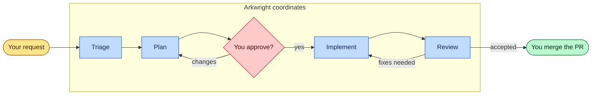

# Arkwright Factory

Arkwright is a team of coding agents that takes a piece of work from a rough request
to a reviewed pull request. You describe a bug or a feature to Arkwright. It
investigates, writes a plan for you to approve, has the change made and
reviewed, and hands you a PR to merge.

It works with [Claude Code](https://code.claude.com),
[Codex CLI](https://github.com/openai/codex), and
[GitHub Copilot CLI](https://github.com/github/copilot-cli). The agents are
plain prompt files, so there is nothing to build or run apart from the tool you
already use.

## How it works

You only ever talk to Arkwright. Behind it are four specialist agents:

| Agent | Job |
| --- | --- |
| `arkwright` | Talks to you and hands work to the other agents. Never edits code. |
| `triage` | Researches the request, reproduces bugs, and finds or creates the issue. |
| `plan` | Interviews you, then writes the plan and commits it to the branch. |
| `implement` | Makes the change, proves it works, and opens the PR. |
| `review` | Reviews the PR adversarially and reports back to Arkwright. Never edits code. |



Arkwright skips stages that aren't needed: a trivial fix doesn't need a plan, and a
link to an open issue doesn't need triage.

Arkwright stops and waits for you when:

- a plan is ready, because no code is written until you approve it
- an agent has a question for you
- review raises a decision that is yours to make
- the PR is reviewed and ready for you to merge

## Install

Clone this repository, then run the script. It asks which tool to install for
(Claude Code, Codex, Copilot, or all that are installed) and whether to install
into the current project or globally.

Clone this repository next to your project:

```bash
git clone https://github.com/matt-major/arkwright-factory.git
```

Then run the script from inside your project:

```bash
cd your-project
```

```bash
../arkwright-factory/install.sh
```

To skip the questions, name the tool and scope:

Claude Code:

```bash
../arkwright-factory/install.sh claude
```

Codex CLI:

```bash
../arkwright-factory/install.sh codex
```

GitHub Copilot CLI:

```bash
../arkwright-factory/install.sh copilot
```

Every tool found on your PATH:

```bash
../arkwright-factory/install.sh all
```

Globally, for every project:

```bash
../arkwright-factory/install.sh -g all
```

| Option | Effect |
| --- | --- |
| `-p`, `--project` | Install into the current project. |
| `-g`, `--global` | Install into your home directory. |
| `-y`, `--yes` | Don't ask. Defaults to all tools, in the project. |
| `--link` | Symlink the files instead of copying them. Don't commit symlinks. |

| Tool | Project | Global |
| --- | --- | --- |
| Claude Code | `.claude/agents/` | `~/.claude/agents/` |
| Codex CLI | `.codex/agents/` | `~/.codex/agents/` |
| Copilot CLI | `.github/agents/` | `~/.copilot/agents/` |

Codex reads profiles only from its home directory, so Arkwright's Codex profile
always goes to `~/.codex`, even for a project install. Codex also loads project
agents only in a trusted project.

To update, pull this repository and run the script again.

## Usage

Start Arkwright from inside the repository you want to work on, then tell it what
you want done, for example "the login page 500s when the email has a plus
sign", or paste a link to an issue.

Claude Code:

```bash
claude --agent arkwright
```

Codex CLI:

```bash
codex -p arkwright
```

GitHub Copilot CLI:

```bash
copilot --agent arkwright
```

Your forge and issue tracker need to be reachable from the tool, for example
through the `gh` CLI or an MCP server, so the agents can open PRs and read and
update issues.

## Layout

```
claude/agents/                  Claude Code  (*.md)
codex/agents/                   Codex CLI    (*.toml)
codex/arkwright.config.toml     Arkwright's Codex profile
copilot/agents/                 Copilot CLI  (*.agent.md)
install.sh
```

The copies for each tool are maintained by hand. When you change how an agent
behaves, make the same change in all three folders.

## License

[MIT](LICENSE)
